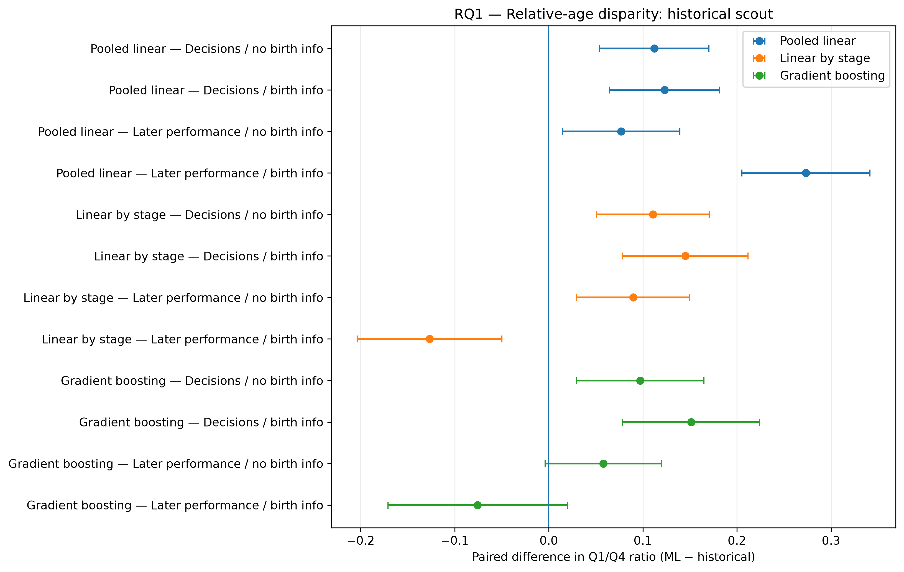
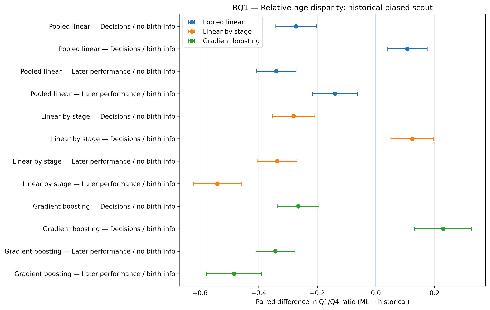
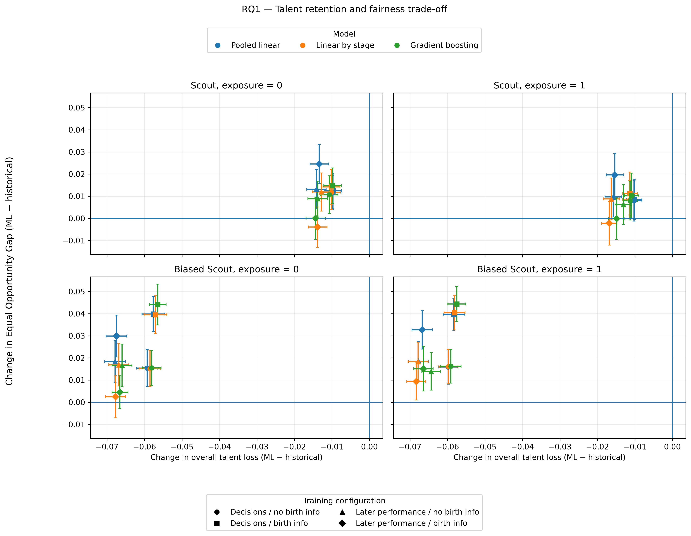

# RQ1 — Amplification of the Relative Age Effect by Machine Learning Selectors

## 1. Research question

**RQ1. How much does a selector trained on historical outcomes amplify the Relative Age Effect (RAE), compared with the bias already present in the data?**

This experiment investigates whether machine-learning selectors reproduce or amplify selection disparities generated by historical human-like selectors. It also examines how the training target, the availability of birth information, model architecture and training exposure affect fairness and selection efficiency.

The simulator uses synthetic athletes whose latent talent is independent of birth date by construction. This allows the experiment to measure the loss of highly talented athletes directly, rather than relying only on observed selection disparities.

## 2. Experimental design

Each experiment uses cohorts of 20,000 synthetic athletes and 20 independent random seeds. For every seed and experimental condition, three historical cohorts are generated using one of two human-like selectors:

- **Scout:** a noisy human-like selector with memory of previous observed performances.
- **Biased Scout:** the same selector, with an additional preference for biologically mature athletes.

Machine-learning selectors are trained on the historical cohorts and evaluated on a fresh test cohort. The historical selector and an Oracle selector are evaluated on the same test cohort.

The experimental grid varies four factors:

| Factor | Conditions |
|---|---|
| Historical selector | Scout; Biased Scout |
| Training exposure weight | 0; 1 |
| Training target | Historical selection decisions; later observed performance |
| Birth information | Withheld; available |

Three model architectures are evaluated:

- **Linear:** pooled logistic regression for decision labels and linear regression for later-performance labels.
- **Linear by stage:** separate linear models for each stage, allowing stage-dependent relationships.
- **Gradient boosting:** histogram-based gradient boosting classifier or regressor, depending on the training target.

The feature set includes current observed performance, mean observed performance over the available history, previous selections and stage. Birth position is optionally added as an input feature. Latent talent and true biological maturation are not made available to the ML selectors.

Three historical cohorts are used for training. The fresh test cohort is independent of the training cohorts. Within each seed and test condition, all evaluated selectors receive the same simulated athletes and performance noise. This common-random-numbers design supports paired comparisons.

All reported RQ1 metrics refer to the final selection stage (stage 2). The default target is latent talent, with the top 10% of the population defined as high talent. The adult-maturation weight is zero.

## 3. Evaluation metrics

The experiment reports six metrics:

- **Q1/Q4 selection-rate ratio:** the selection rate of athletes born in Q1 divided by the selection rate of athletes born in Q4. A value above one indicates an advantage for Q1.
- **Overall talent loss:** the proportion of high-talent athletes not selected at the final stage.
- **Q4 talent loss:** the proportion of high-talent Q4 athletes not selected at the final stage.
- **Equal Opportunity Gap:** the largest difference in talent loss between any two birth quarters.
- **Mean selected talent:** the mean latent talent of the selected athletes.
- **Regret:** the difference between the mean talent of an Oracle-selected cohort of the same size and the mean talent of the actual selected cohort.

The Q1/Q4 ratio measures selection disparity, whereas talent loss measures harm to athletes with high latent talent. These quantities are related but are not interchangeable.

Results are averaged over 20 seeds. Confidence intervals use the Student-t distribution with a 95% confidence level. Differences between an ML selector and its historical selector are computed within the same seed:

\[
\Delta = \text{Metric}_{ML} - \text{Metric}_{historical}.
\]

For the Q1/Q4 ratio and the Equal Opportunity Gap, positive differences indicate greater disparity. For talent loss and regret, negative differences indicate improvement. For mean selected talent, positive differences indicate improved selection efficiency.

## 4. Historical selector baseline

The historical selectors already exhibit substantial relative-age disparities before considering the behaviour of ML selectors.

**Final-stage results, mean ± 95% confidence-interval half-width across 20 seeds:**

| Historical selector | Exposure | Q1/Q4 ratio | Overall loss | Q4 loss | EO gap | Mean talent | Regret |
|---|---:|---:|---:|---:|---:|---:|---:|
| Scout | 0 | 2.956 ± 0.073 | 0.661 ± 0.004 | 0.781 ± 0.007 | 0.250 ± 0.007 | 0.922 ± 0.008 | 0.841 ± 0.006 |
| Biased Scout | 0 | 3.373 ± 0.089 | 0.715 ± 0.004 | 0.832 ± 0.006 | 0.245 ± 0.008 | 0.762 ± 0.009 | 1.001 ± 0.009 |
| Scout | 1 | 3.011 ± 0.086 | 0.665 ± 0.004 | 0.787 ± 0.009 | 0.253 ± 0.011 | 0.913 ± 0.008 | 0.850 ± 0.007 |
| Biased Scout | 1 | 3.374 ± 0.091 | 0.717 ± 0.004 | 0.833 ± 0.006 | 0.244 ± 0.009 | 0.757 ± 0.010 | 1.006 ± 0.009 |

The historical Scout already produces a Q1/Q4 ratio close to three. Adding an explicit maturation preference increases it to approximately 3.37 and raises overall and Q4 talent loss. The Biased Scout also selects a cohort with lower mean latent talent and higher regret.

The Oracle provides a benchmark: it selects the highest-talent athletes and has zero talent loss and zero regret. Its observed Q1/Q4 ratio is close to one, with small deviations due to finite-sample variation.

## 5. Comparison with the previous implementation

The previous repository reports RQ1 results in [report/report.md, Section 5.2](https://github.com/Keniota02/rae-feedback-loops/blob/main/report/report.md).

Its historical Q1/Q4 ratios with exposure disabled are 2.95 for the Scout and 3.36 for the Biased Scout. The present implementation obtains 2.956 and 3.373, respectively.

The agreement supports the conclusion that the reimplementation preserves the original model calibration and the magnitude of the baseline RAE.

The following table compares the paired Q1/Q4 differences reported in the previous repository with those obtained in the current experiments. All values refer to exposure disabled. New values are shown as mean paired difference ± 95% confidence-interval half-width.

### Historical source: Scout

| Training target | Birth info | Previous: Linear | Previous: Per-stage | Previous: GBM | Current: Linear | Current: Per-stage | Current: GBM |
|---|---|---:|---:|---:|---:|---:|---:|
| Decisions | No | +0.09 | +0.09 | +0.08 | +0.112 ± 0.058 | +0.111 ± 0.060 | +0.097 ± 0.067 |
| Decisions | Yes | +0.09 | +0.08 | +0.13 | +0.123 ± 0.059 | +0.145 ± 0.066 | +0.151 ± 0.073 |
| Later performance | No | +0.06 | +0.06 | +0.03 | +0.077 ± 0.062 | +0.090 ± 0.060 | +0.058 ± 0.062 |
| Later performance | Yes | +0.24 | −0.14 | +0.02 | +0.273 ± 0.068 | −0.127 ± 0.077 | −0.076 ± 0.095 |

### Historical source: Biased Scout

| Training target | Birth info | Previous: Linear | Previous: Per-stage | Previous: GBM | Current: Linear | Current: Per-stage | Current: GBM |
|---|---|---:|---:|---:|---:|---:|---:|
| Decisions | No | −0.29 | −0.28 | −0.28 | −0.272 ± 0.069 | −0.281 ± 0.072 | −0.265 ± 0.070 |
| Decisions | Yes | +0.12 | +0.12 | +0.20 | +0.107 ± 0.068 | +0.124 ± 0.073 | +0.229 ± 0.097 |
| Later performance | No | −0.36 | −0.35 | −0.37 | −0.340 ± 0.067 | −0.337 ± 0.068 | −0.343 ± 0.066 |
| Later performance | Yes | −0.16 | −0.54 | −0.42 | −0.140 ± 0.076 | −0.541 ± 0.081 | −0.484 ± 0.094 |

The new results reproduce the main patterns of the previous implementation. Differences are generally small relative to the reported confidence intervals and do not change the qualitative interpretation.

This is a comparison of published aggregate results, not an exact replication test: the previous repository does not track its per-seed RQ1 result files. Consequently, paired statistical comparisons between the two implementations cannot be performed.

## 6. Machine-learning results

### 6.1 Amplification depends on the training target and model

The paired Q1/Q4 results show that ML selectors do not amplify the RAE uniformly.

When the historical source is the Scout, decision-trained models generally increase the Q1/Q4 ratio slightly. Later-performance models without birth information also produce small positive differences. However, when birth information is included in the later-performance regime, the pooled linear model increases the ratio substantially, while the per-stage model reduces it and the GBM result is inconclusive.

When the historical source is the Biased Scout, models trained without birth information generally reduce the Q1/Q4 ratio. This is consistent with the model being unable to reconstruct the historical preference for biological maturation when the relevant birth-date proxy is withheld.

Adding birth information changes this behaviour: decision-trained models increase the ratio relative to the historical selector. In the later-performance regime, all three model types reduce the ratio, with the largest reductions obtained by the per-stage linear model and GBM.

These results indicate that amplification is not determined by the historical data alone. It also depends on the training target, feature availability and model architecture.

**Figure 1. Paired Q1/Q4 differences when the historical data are generated by the Scout.** Positive values indicate a higher Q1/Q4 ratio for the ML selector than for its historical baseline. Error bars show paired 95% Student-t confidence intervals. Exposure is disabled.

**Figure 2. Paired Q1/Q4 differences when the historical data are generated by the Biased Scout.** Positive values indicate a higher Q1/Q4 ratio for the ML selector than for its historical baseline. Error bars show paired 95% Student-t confidence intervals. Exposure is disabled.

### 6.2 Talent loss and selection efficiency

For each metric, there are 48 paired ML-versus-historical comparisons: three model architectures, four training configurations, two historical selectors and two exposure settings.

Across these comparisons:

- Overall talent loss is lower in all 48 comparisons, with all paired 95% confidence intervals below zero.
- Mean selected talent is higher in all 48 comparisons, with all paired 95% confidence intervals above zero.
- Regret is lower in all 48 comparisons, with all paired 95% confidence intervals below zero.
- Q4 talent loss is lower in all 48 point estimates; 34 confidence intervals exclude zero, while 14 include zero.

Averaging the 48 paired differences, ML selectors reduce overall talent loss by approximately 0.038 (3.8 percentage points) and increase mean selected talent by approximately 0.113 latent-talent units.

The mean regret reduction is approximately 0.113. This is not an independent result from mean selected talent: regret is defined relative to the Oracle cohort of the same size, so the two differences are equal in magnitude and opposite in sign.

### 6.3 Fairness is not guaranteed by improved efficiency

The Equal Opportunity Gap point estimate is positive in 45 of the 48 paired comparisons. In 36 comparisons, the paired 95% confidence interval is entirely above zero; in the remaining 12, it includes zero. No comparison has a confidence interval entirely below zero.

The Q1/Q4 ratio has a mixed pattern: 20 paired confidence intervals indicate a decrease, 21 indicate an increase, and seven include zero.

This is an important distinction. ML selectors generally retain more high-talent athletes and improve the mean talent of the selected cohort, but these improvements do not consistently reduce disparities between birth quarters.

A reduction in Q4 talent loss does not necessarily imply a reduction in the Equal Opportunity Gap. The gap depends on the difference in talent loss across all quarters, not on Q4 alone.

The confidence-interval counts above are descriptive: no correction for multiple comparisons has been applied. They should not be interpreted as a single global hypothesis test.

**Figure 3. Paired change in overall talent loss and Equal Opportunity Gap for ML selectors relative to their historical baselines.** Points are grouped by historical selector and exposure condition. Negative values on the horizontal axis indicate lower overall talent loss; positive values on the vertical axis indicate a larger Equal Opportunity Gap. Error bars show paired 95% Student-t confidence intervals.

## 7. Effect of training exposure

The RQ1 experiment also evaluates exposure weights of zero and one.

For the historical Scout, changing the exposure weight from zero to one increases the Q1/Q4 ratio by approximately 0.055, overall talent loss by approximately 0.0033 and Q4 talent loss by approximately 0.0062. The paired 95% confidence intervals for these three changes are above zero. The Equal Opportunity Gap change is not distinguishable from zero at the 95% level.

For the Biased Scout, the exposure condition increases overall talent loss by approximately 0.0018, with a paired 95% confidence interval above zero. The Q1/Q4 ratio, Q4 talent loss and Equal Opportunity Gap changes are not distinguishable from zero at the 95% level.

These findings are consistent with the previous repository: training exposure has an effect, but it is modest relative to the baseline maturation-related bias. The multi-stage and cross-cohort dynamics of the feedback loop are examined separately in RQ2.

## 8. Answer to RQ1

The experiments show that machine-learning selectors trained on historical outcomes do not amplify the Relative Age Effect in a uniform or inevitable way.

The historical Scout already exhibits a substantial RAE, and the explicit maturation preference of the Biased Scout increases both disparity and talent loss. ML selectors trained on the resulting historical data usually improve overall talent retention and selection efficiency. However, whether they amplify or reduce the Q1/Q4 disparity depends on the training target, whether birth information is available, and the model architecture.

Three mechanisms help explain the results:

1. **Denoising:** models imitating noisy historical decisions can preserve systematic selection preferences while reducing random judgement noise.
2. **Proxy reconstruction:** birth information can help a model reproduce a historical preference for biological maturation. Withholding it can reduce this channel of bias, although birth-related information may remain encoded in performance history.
3. **Stage-dependent label bias:** later observed performance still contains maturation effects, and their strength changes across stages. A pooled model and a stage-specific model can therefore learn different relationships and produce different final-stage disparities.

The central conclusion is that improved selection efficiency does not guarantee improved fairness. Auditing only overall accuracy or talent retention would miss disparities across birth quarters. Both disparity measures and talent-loss measures should be examined when evaluating data-driven talent selection.

## 9. Limitations

The results describe a synthetic simulation and do not predict real-world sporting outcomes. The model assumes that latent talent is independent of birth date, uses a simplified maturation mechanism and represents training exposure as an additive contribution to observed performance.

The later-performance regime also has selective labels: only athletes who remain in the system can contribute next-stage performance observations.

The experiment uses 20 random seeds. Although paired confidence intervals improve the comparison between selectors, the number of seeds is limited and no multiple-comparison correction is applied to the collection of paired tests.

Finally, the comparison with the previous implementation relies on aggregate values in its report. The old per-seed results are not available in the repository, so the comparison cannot establish exact numerical replication.

The simulator is intended to explore mechanisms and compare selection policies. It does not use personal data and should not be interpreted as a predictor of individual athletes' real-world potential.
